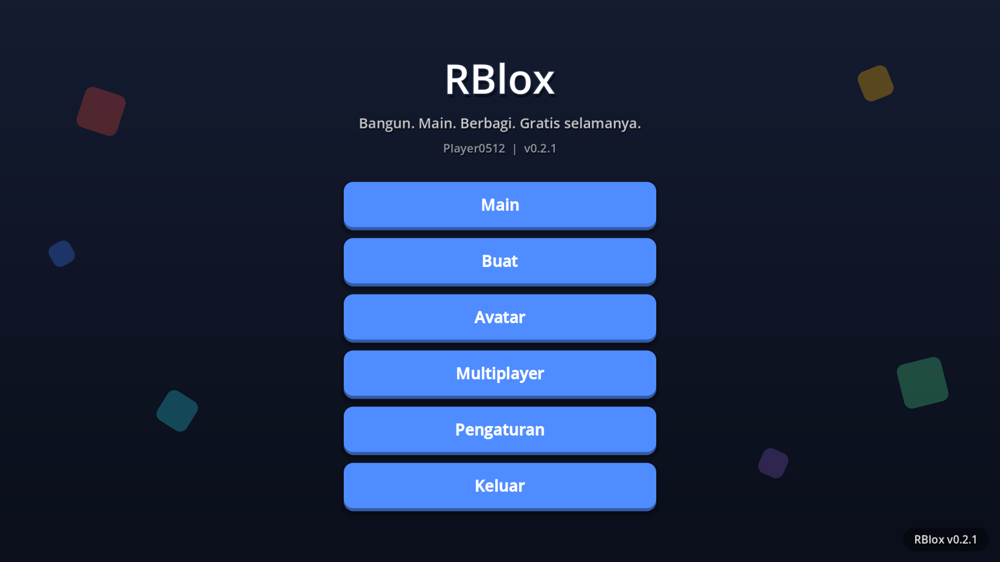
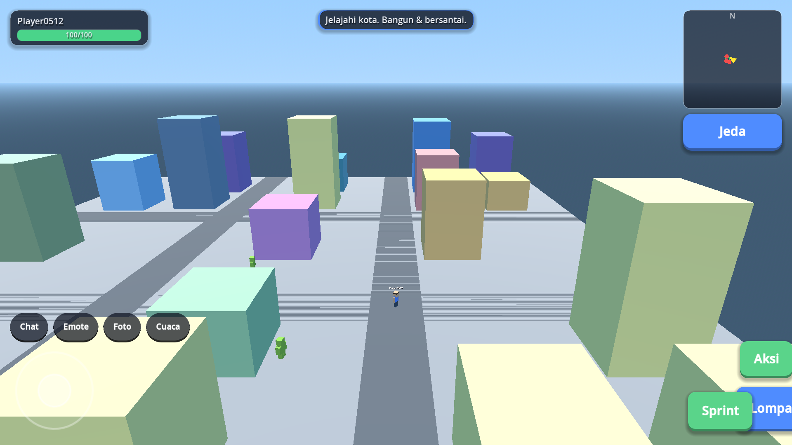
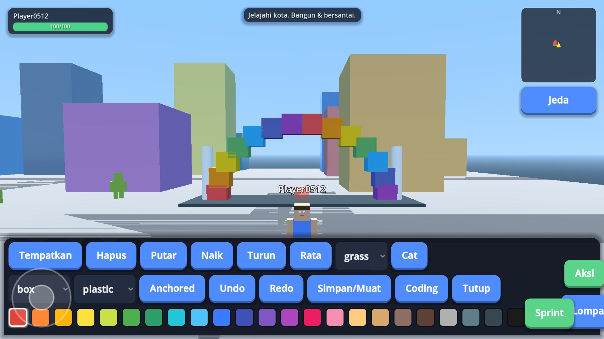
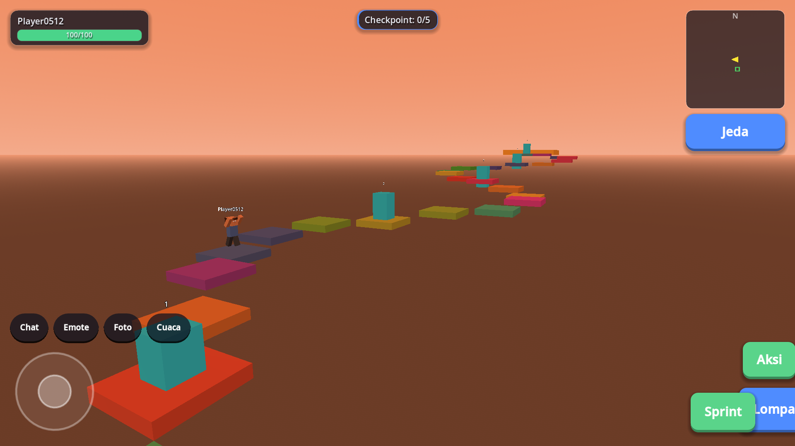
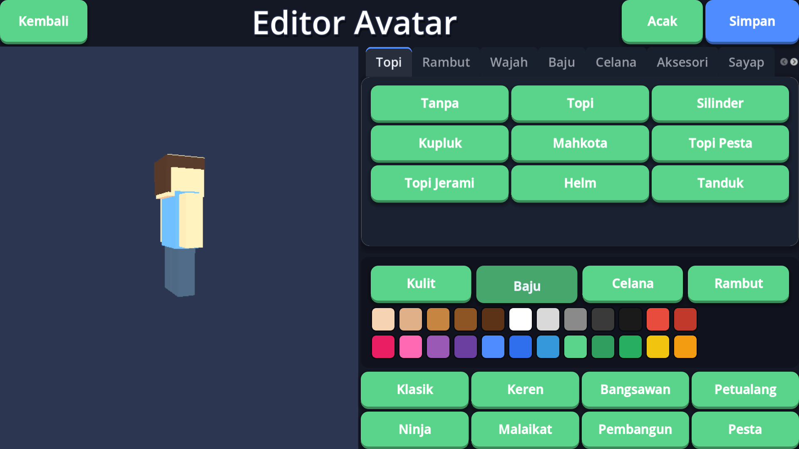

# REABLOX — Platform Game Sandbox 3D Gratis Terinspirasi Roblox

[](https://github.com/SecretArrow/Reablox/actions/workflows/ci.yml)
[](https://github.com/SecretArrow/Reablox/actions/workflows/android-build.yml)

**Reablox** adalah **game** sandbox 3D bergaya blocky (terinspirasi konsep Roblox) untuk **Android 7.0+ (API 24)**, dibangun dengan **Godot 4.4**. Ini bukan launcher, bukan browser, dan bukan katalog — ini pengalaman bermain sungguhan: dunia virtual 3D, karakter, eksplorasi, obby, racing, survival, tycoon, build mode, dan multiplayer lokal.

> **100% GRATIS — selamanya.** Tanpa iklan, tanpa in-app purchase, tanpa subscription, tanpa premium, tanpa pay-to-win. Semua item kosmetik terbuka lewat gameplay. Tidak wajib registrasi; data tersimpan lokal di perangkat. Tidak ada integrasi pembayaran dalam bentuk apa pun (dijaga oleh test otomatis `test_policy_free`).

## Pratinjau

| Menu Utama | Gameplay (Kota) |
|---|---|
|  |  |
| **Mode Build** (lengkung pelangi + HUD block coding) | **Obby** (spiral platform saat senja) |
|  |  |
| **Editor Avatar** (52 kosmetik + preset) | |
|  | |

> Semua gambar dirender langsung dari engine 1080p (mode `--screenshot-demo`
> via Xvfb + Mesa software GL) — bukan mockup; lihat
> [docs/CI_CD.md](docs/CI_CD.md) untuk cara mereproduksi.

## Fitur Gameplay

| Kategori | Detail |
|---|---|
| **Avatar** | Karakter blocky 3D + editor lengkap: 52 item kosmetik (topi, rambut, wajah, baju, celana, aksesori, sayap, tas, senjata), 8 preset, palet warna, ekspresi wajah prosedural |
| **10 Dunia Gameplay Nyata** | Obby (checkpoint), Tycoon (income + konveyor), Racing (kart + lap + checkpoint), Kota Roleplay (NPC + kart + bangunan), Survival (wave musuh + crafting), Horror (misari misteri + senter), Bedwars (base defense), Hide & Seek, Adventure (koleksi + quest), World Kosong — semua dengan objective, menang/kalah, skor, restart |
| **Multiplayer Lokal** | Host-client via **LAN/Hotspot** hingga 16 pemain (ENet port 24565) + auto-discovery room (UDP 24566), lobby, chat teks + quick emote, kick (host), reconnect otomatis, sinkronisasi posisi & blok |
| **Build Mode** | Tempatkan/hapus/putar/skala blok (box, sphere, cylinder, wedge), 5 material, 24 warna, anchored/dynamic (fisika), undo-redo 50 langkah, terrain editor (naik/turun/rata/cat), grid snapping, maks 4000 blok |
| **Scripting** | Block coding visual (tap-based, 9 perintah) untuk pemula + mini scripting berbasis Expression untuk pengguna mahir |
| **Save/Share** | Simpan/muat/lanjutkan (resume state) world lokal, ekspor/impor file `.myworld` (JSON) untuk dibagikan |
| **Progresi** | Achievement offline, XP & level, statistik per mode, tutorial interaktif — semua reward murni dari gameplay |
| **Dunia Interaktif** | Siklus siang-malam, cuaca (hujan/salju/kabut), NPC bot dengan AI, minimap, checkpoint, spawn point |
| **UI/UX** | Tombol besar (≥48dp), Bahasa **Indonesia + English**, **Dark & Light mode**, kontrol sentuh (joystick + drag kamera) + gamepad Bluetooth |
| **Performa** | Renderer mobile Godot, target 60 FPS di RAM 3-4GB, APK < 300MB, polygon budget otomatis per kategori |

## Kontrol

| Aksi | Sentuh | Keyboard | Gamepad |
|---|---|---|---|
| Gerak | Joystick kiri | WASD | Left stick |
| Kamera | Drag area kanan | — | — |
| Lompat | Tombol Lompat | Spasi | A |
| Sprint | Tombol Lari | Shift | LB |
| Aksi/Masuk kart | Tombol Aksi | E | X |
| Build mode | Tombol Bangun | B | — |
| Chat | Tombol Chat | T | — |
| Pause | Tombol Pause | Esc | — |

## Struktur Proyek

```
Reablox/
├── project.godot           # Konfigurasi Godot 4.4 (mobile renderer, landscape)
├── export_presets.cfg      # Android (gradle, minSdk 24 / targetSdk 34) + fallback
├── scenes/                 # 9 scene inti (root + script, UI dibangun programatik)
├── scripts/
│   ├── autoload/           # Settings, Locale, GameState, Saves, Net (facade)
│   ├── player/             # Player controller, kamera, touch controls
│   ├── avatar/             # Avatar builder + cosmetics DB
│   ├── build/              # Build manager, block library, terrain, coding
│   ├── multiplayer/        # LAN backend, lobby, chat, transport stubs
│   ├── world/              # Game orchestrator, templates, 10 modes, NPC, kart
│   ├── ui/                 # Menu, HUD, editor, tutorial, toast, minimap
│   └── meta/               # Screenshot & utilitas
├── data/                   # cosmetics.json (52 item), locales (id/en)
├── android_plugins/        # Skeleton plugin Bluetooth (Alpha)
├── tools/
│   ├── tests/              # Test suite headless (unit + integration + gameplay)
│   ├── apk-tester/         # Autonomous APK tester (emulator E2E)
│   ├── ci_autofix.py       # Auto-fix CI (format + locale)
│   └── ...
├── docs/                   # ARCHITECTURE, ROADMAP, CI_CD, MULTIPLAYER
└── .github/workflows/      # ci.yml, tests.yml, android-build.yml, release.yml, autofix.yml, universal-apk-test.yml
```

## Build & Rilis (GitHub Actions — tanpa build lokal)

Tidak perlu build lokal. Pipeline otomatis:

1. **`ci.yml`** — Quality gate: lint (`gdlint` + `gdformat --check`) + unit/integration/gameplay tests (headless Godot). Berjalan di setiap push & PR.
2. **`android-build.yml`** — Build APK **signed release keystore** (dari GitHub Secrets) → verifikasi signature `apksigner` → E2E smoke test di emulator Android → gate release. Build hanya jalan setelah quality gate lolos.
3. **`tests.yml`** — E2E DEEP eksplorasi UI otomatis di emulator (nightly + manual).
4. **`release.yml`** — Release otomatis: pre-release `dev-build` tiap push ke `main`; rilis stabil dari tag `v*`.
5. **`autofix.yml`** — Auto-fix (format + locale) saat CI gagal + issue otomatis.

Unduh APK:
1. Tab **[Actions](../../actions)** → run terbaru → artifact **Reablox-Android**, atau
2. **[Releases](../../releases)**: pre-release `dev-build` diperbarui otomatis tiap push ke `main`; rilis stabil dari tag `v*` (APK sudah diverifikasi signature-nya).

Install: izinkan "Install dari sumber tidak dikenal" di pengaturan Android. Pilih sesuai CPU: `arm64-v8a` (HP modern), `armeabi-v7a` (HP lama), `x86_64` (emulator/ChromeOS), `universal` (semua).

## Testing

Semua fitur diuji otomatis berdasarkan fungsinya (bukan cuma "halaman kebuka"):

- **Unit + integration** (`tools/tests/`, dijalankan `ci.yml`): ekonomi & progresi (koin hanya dari gameplay), avatar & kosmetik (semua gratis), save/load roundtrip + kompatibilitas format lama, build mode (place/remove/undo/redo/grid snap), 10 template dunia valid, gerakan & fisika pemain, logika mode game (obby checkpoint, racing lap, survival wave, tycoon income), locale, dan **policy guard anti-monetisasi**.
- **E2E** (`universal-apk-test.yml`): APK di-install di emulator Android, diluncurkan, dijelajahi otonom, crash detection + diagnosis + repair loop.

Jalankan lokal (tanpa export Android): `godot --headless res://tools/tests/test_all.tscn`

## Dokumentasi Lanjutan

- [Arsitektur Kode](docs/ARCHITECTURE.md)
- [Rencana Pengembangan MVP → Alpha → v1.0](docs/ROADMAP.md)
- [Pipeline CI/CD](docs/CI_CD.md)
- [Protokol Multiplayer](docs/MULTIPLAYER.md)
- [Performa & Polygon Budget 60 FPS](docs/PERFORMANCE.md)
- [Asset Pipeline AI → Blender → Godot](docs/ASSET_PIPELINE.md) + prompt library [`prompts/`](prompts/)

## Lisensi

Kode proyek ini bebas digunakan dan dimodifikasi. "Reablox" tidak berafiliasi dengan Roblox Corporation; seluruh aset dan implementasi adalah original.
